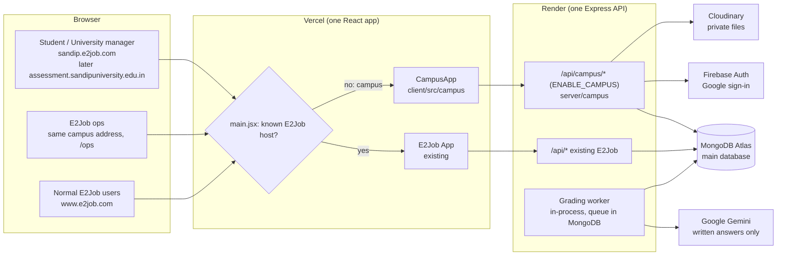
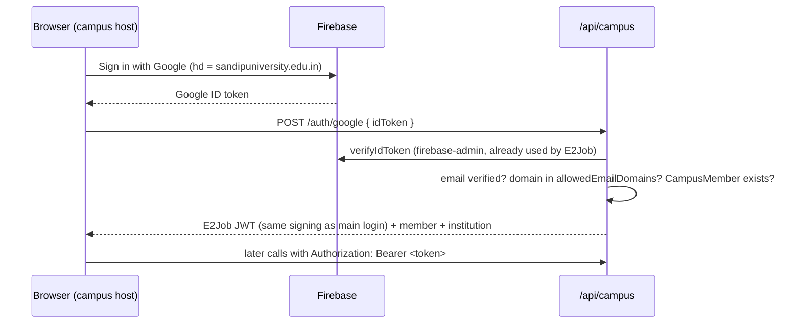

# Architecture: Campus module (Sandip University portal)

| | |
|---|---|
| Status | Draft v1, 18 Oct 2026 |
| Requirements | [PRD](./sandip-university-prd.md) (R1 to R16 referenced below) |
| Decision | Option A: same repo, same Express API, same MongoDB, same React app. The campus code lives in its own folders behind a feature flag, so it can later move to its own frontend (option C) in 1 to 2 days. |

## 1. Big picture



- One deploy for both. The campus part is a separate lazily loaded bundle, so E2Job users never download it.
- One database. Campus data sits in its own collections and points to the normal `User` document, so the 60 students are E2Job users too (the "master" data requirement).
- The whole module is off unless `ENABLE_CAMPUS=true` (server) and `VITE_ENABLE_CAMPUS=true` (client).

## 2. Code layout and separation rules

```
server/
  campus/
    index.js            # router mounted at /api/campus when ENABLE_CAMPUS=true
    models/             # Institution, Batch, CampusMember, CampusAssessment, CampusAttempt,
                        # CampusGradingJob, CampusSession, CampusAttendance
    controllers/        # tenant, auth, profile, import, assessment, attempt, review, sessions, reports
    middleware/         # resolveTenant, campusAuth, requireCampusRole, requireE2JobAdmin
    services/           # scoring, grading worker, gemini grader, similarity, reports, uploads
    __tests__/ (or server/__tests__/integration/campus*.test.js)
client/src/
  campus/
    CampusApp.jsx       # own router, own layout, own small state (React context, not Redux)
    api.js              # axios instance for /api/campus, token key "campus_token"
    pages/              # Landing, SignIn, Consent, Profile, Dashboard, Test, Result,
                        # manager/*, ops/*
    components/
  shared/               # the only code both apps use: firebase config, safe URL helpers,
                        # BrandLogo-style primitives (copied, not imported from pages/)
```

Rules (these keep option C open):
1. `client/src/campus` imports only from `client/src/campus` and `client/src/shared`. Never from `pages/`, `components/`, `redux/` of the main app.
2. The main app never imports campus code. The only touch point is `main.jsx`, which picks the app by host.
3. The campus client talks only to `/api/campus/*` (plus Firebase).
4. `server/campus` may use shared server utilities (auth token signing, Cloudinary config, rate limiters, AuditLog), but existing controllers and models are not changed for campus needs. Campus data lives in campus collections.

## 3. Multi-tenancy (one code, many universities)

`Institution` document per university:

| Field | Example |
|---|---|
| `slug` | `sandip` |
| `name`, `logoUrl`, `brandColor` | Sandip University, `/campus/sandip-logo.png`, `#8B1E24` |
| `domains` | `["sandip.e2job.com", "assessment.sandipuniversity.edu.in"]` |
| `allowedEmailDomains` | `["sandipuniversity.edu.in"]` (demo tenant may add test domains) |
| `helpContact` | email or phone shown on errors |
| `status` | `active` / `inactive` |

Resolution:
- Client: `main.jsx` decides without any network call: the known E2Job hosts (`e2job.com`, `www.e2job.com`, `localhost`, `127.0.0.1`) render the normal app, so E2Job users pay nothing extra. Any other host renders the lazily loaded CampusApp, which then calls `GET /api/campus/tenant` to load the institution's name, logo and colours (404 shows a "portal not found" page). A new university therefore needs no redeploy, only an `Institution` entry and the domain setup in section 12. For local development, `localhost/?campus=sandip` opens the campus app for that tenant.
- Server: `resolveTenant` reads the host from the request `Origin` (not a client-chosen header) and loads the Institution. Every campus query is filtered by `institutionId`.
- Authorization never trusts the tenant from the client: a signed-in user's `CampusMember.institutionId` must equal the resolved tenant, otherwise 403.
- CORS: the server already reads allowed origins from `CLIENT_URL`; each campus domain is added there (and in Firebase "authorized domains").

## 4. Data model (new collections only)

| Collection | Key fields | Notes |
|---|---|---|
| `Institution` | slug, name, logoUrl, domains[], allowedEmailDomains[], status | Unique slug and domains |
| `Batch` | institutionId, name ("MBA 2025-27"), bands config | Bands: `<6.0` = 1, `6.0-7.99` = 2, `>=8.0` = 3 (R7) |
| `CampusMember` | userId, institutionId, batchId, role (`student` / `manager`), rollNo, phone, cgpa, band (derived), verification {cgpa, details: status, by, at}, consentAt, importedAt | Unique (institutionId, email) and (institutionId, rollNo). Band is computed in a model hook, never sent by the client. |
| `CampusAssessment` | institutionId, batchId, title, opensAt, closesAt, timeLimitMinutes (60), maxAttempts (1), sections[], questions[] | Question: id, section, type (`mcq` / `written` / `speaking`), prompt, options[], correctOptionId (mcq), rubric (written / speaking), points. Answers and rubrics are never sent to students. |
| `CampusAttempt` | assessmentId, userId, institutionId, status (`in_progress` / `submitted` / `auto_submitted`), startedAt, deadlineAt, questionOrder[], optionOrder{}, answers[{questionId, optionId / text / audioAssetId, savedAt}], proctor {events[{type, at}], warnings, snapshots[{assetId, at}], flags[]}, scores {bySection, total, mcq, written, speaking}, review {status, by, at, changes[]}, publishedAt | Unique (assessmentId, userId) enforces one attempt (R9) |
| `CampusGradingJob` | attemptId, questionId, kind (`written`), status (`queued` / `running` / `done` / `failed`), tries, nextRunAt, lockedUntil, result {score, maxScore, reason, model}, error | The AI queue (R11) |
| `CampusSession` | institutionId, batchId, band (null = all), title, startAt, endAt, meetUrl, trainerName | R13 |
| `CampusAttendance` | sessionId, userId, joinedAt | Unique (sessionId, userId) |

The student's own `User` document is a normal E2Job student (`role: user`, `userType: student`). Name and email live there; campus-specific fields live in `CampusMember`.

## 5. Sign-in and roles (R4, R5)



- Only imported emails can sign in; anyone else gets "Your email is not registered for this program" (R4).
- Campus requests are authenticated **only by the `Authorization: Bearer` header** (`server/campus/middleware/bearer.js`). The shared E2Job `protect` prefers the session and the `token` cookie, so a browser that is also signed in to E2Job (admin or employer) would otherwise act as that account inside the portal. The campus client never sends cookies.
- The first call after sign-in returns `needsConsent` until `POST /consent` is called (R5). Every campus endpoint except tenant, auth and consent rejects a member without `consentAt`.
- Roles:
  - `student` and `manager` are `CampusMember.role` and sign in with Google the same way.
  - E2Job ops use the existing admin login (`POST /api/admin/login`, `SUPER_ADMIN`) from the campus `/ops` screens. `requireE2JobAdmin` checks that role.

## 6. API (all under `/api/campus`)

| Area | Endpoints | Who |
|---|---|---|
| Tenant | `GET /tenant` (host from the request Origin; `?campus=` only in development) | public |
| Auth | `POST /auth/google`, `GET /me`, `POST /consent` | student, manager |
| Profile | `GET /profile`, `PATCH /profile` (edits reset verification to pending) | student |
| Import | `POST /ops/import/preview` (xlsx/csv upload, row errors), `POST /ops/import/commit` | E2Job admin |
| Verification | `GET /ops/members?status=pending`, `POST /ops/members/:id/verify` | E2Job admin |
| Assessment | `GET /assessments` (status for me), `POST /assessments/:id/start`, `GET /attempts/:id` (questions without answers, remaining time), `PUT /attempts/:id/answers/:qid`, `POST /attempts/:id/audio/:qid`, `POST /attempts/:id/events`, `POST /attempts/:id/snapshot`, `POST /attempts/:id/submit`, `GET /results/me` | student |
| Review | `GET /ops/assessments/:id/review` (flagged first), `PATCH /ops/attempts/:id/scores`, `POST /ops/assessments/:id/publish` | E2Job admin |
| Sessions | `GET /sessions/next`, `GET /sessions`, `POST /sessions/:id/join` (records attendance, returns meetUrl), `POST /ops/sessions`, `POST /ops/sessions/import` | student / E2Job admin |
| Manager | `GET /manager/students?band=&status=`, `GET /manager/summary`, `GET /manager/reports/results.xlsx`, `.../summary.pdf`, `.../scorecards.pdf`, `.../attendance.xlsx` | manager, E2Job admin |

All inputs are validated server-side; the client never sends scores, bands, deadlines or roles.

## 7. Test engine (R9, R10)

- **Start:** creates the single `CampusAttempt` (unique index), sets `deadlineAt = min(now + 60 min, closesAt)`, stores a per-student shuffle of question and option order. A second start returns the existing attempt.
- **Server timer:** every read returns `remainingSeconds = deadlineAt - now`. Answer saves after `deadlineAt + 5 s` are rejected. A sweep runs every minute and also on every read to auto-submit expired attempts, so a closed browser still ends the test on time.
- **Autosave:** each answer is saved on change (`PUT .../answers/:qid`), so refresh or device change resumes with the saved answers.
- **Speaking:** the browser records with MediaRecorder (webm/opus, max 90 s), lets the student replay, then uploads to Cloudinary as a private (`authenticated`) file; the attempt stores the asset id.
- **Fair-test events:** the client reports `fullscreen_exit`, `tab_hidden`, `window_blur`, `camera_lost`, `paste_blocked`. The server counts them; on the 3rd counted event it auto-submits with reason `tab_switching` (R10). Copy, paste and right-click are blocked in the client; option and question order are shuffled per student.
- **Camera and microphone gate:** before Start, the client must get `getUserMedia({ video, audio })`. If denied, the Start button stays disabled with instructions (decision: no test without camera). The server also requires the first snapshot within 60 s of start and expects one every 3 minutes; a missing snapshot is recorded as a `camera_lost` event. This is what can be enforced from a browser; it cannot stop a determined user from faking a camera, so snapshots are kept for human review.
- **Snapshots:** 320 px JPEG every 3 minutes, uploaded as private Cloudinary files; viewed only through short-lived signed URLs by E2Job admins and the university manager.

## 8. Scoring and AI grading (R11, R12)

- **Multiple choice:** scored at submit by comparing with `correctOptionId`. No AI.
- **Written answers:** one `CampusGradingJob` per answer.
  - Worker: an in-process loop (every 5 s) claims due jobs with `findOneAndUpdate` (status `queued`, `nextRunAt <= now`, sets `lockedUntil`), so a restart or a second instance never double-grades. Concurrency 2. On a rate limit or error: retry with backoff (30 s, 2 min, 10 min, then `failed` for manual marking).
  - Gemini call uses the existing `@google/generative-ai` package and `GEMINI_API_KEY`, temperature 0, JSON output `{ score, maxScore, reason }`, validated before saving.
  - Data sent: question text, rubric and the answer text only. No name, email, roll number or ids.
  - 60 students × 3 answers = 180 calls. With concurrency 2 and a few seconds per call this finishes in well under 30 minutes, even with retries.
- **Speaking:** no AI (decision). The review screen plays each recording; the reviewer enters a score against the rubric.
- **Copy check:** when the assessment closes, written answers per question are compared pairwise (word 3-gram overlap); pairs above a threshold get a `possible_copy` flag on both attempts.
- **Review and publish:** reviewers see flagged and AI-failed items first, can change any score with a note (stored in `review.changes` and in the existing `AuditLog`), then Publish sets `publishedAt` for all attempts. Students get results only after that.
- **Student result:** total, score per section, strengths and improvements (taken from the AI reasons and section scores). No answer key.

## 9. Training sessions (R13)

- Sessions are filtered by the member's batch and band. `GET /sessions/next` returns the next one.
- Join is enabled from 15 minutes before `startAt` until `endAt`; `POST /sessions/:id/join` records attendance once (unique index) and returns the Meet link, so the link is only revealed in that window.
- Bulk import of a schedule from a sheet, same preview-then-commit pattern as student import.

## 10. Reports (R14)

- Generated on the server from the same queries as the dashboard, so numbers match.
- PDF: `pdfkit` (already a server dependency, used for offer letters).
- Excel: proposal is to add `exceljs` for real `.xlsx` files. If we prefer no new dependency for the demo, CSV with a UTF-8 BOM opens in Excel (the ATS export already does this). Decision for Vivek.
- Import of the university's sheet needs the same: `exceljs` to read `.xlsx`, or we accept CSV only for the demo.

## 11. Security and privacy (R15)

- Tenant isolation: every campus query includes `institutionId`; a helper builds scoped queries, and tests check that one institution cannot read another's members, attempts or reports.
- Students can read only their own member, attempts and results. Managers can read only their institution. Ops require `SUPER_ADMIN`.
- Files (audio, snapshots) are private Cloudinary assets, served only through signed URLs valid for a few minutes.
- AI receives no personal data (section 8).
- Rate limits on auth, answer saving and uploads; payload size limits on audio (max about 2 MB) and snapshots.
- Audit log for imports, verification changes, score changes and publishing.
- Consent stored with timestamp; text mentions E2Job as operator, AI checking of written answers, and camera use.

## 12. Deployment

| Item | Owner | Detail |
|---|---|---|
| Feature flags | Vivek | `ENABLE_CAMPUS=true` on Render, `VITE_ENABLE_CAMPUS=true` on Vercel |
| Demo address | Imran | Cloudflare CNAME `sandip` to Vercel; add `sandip.e2job.com` to the Vercel project |
| CORS | Vivek | Add `https://sandip.e2job.com` to `CLIENT_URL` on Render |
| Firebase | Vivek | Add `sandip.e2job.com` (later the university domain) to Firebase authorized domains |
| Secrets | Vivek | `GEMINI_API_KEY` and Cloudinary keys already on Render; confirm Gemini quota |
| Later: university domain | University IT | CNAME `assessment.sandipuniversity.edu.in` to Vercel; we add it to `Institution.domains`, Vercel, CORS and Firebase |

Load: 60 students on one Render Starter instance is well within the 100-user load test of 6 Oct. Grading runs in the same process at low concurrency.

## 13. Demo data and testing

- Seed script `server/scripts/seed-campus-demo.js` (refuses to run unless the database is the QA database or `--allow-production-demo` is passed for the demo tenant): creates the Sandip demo institution, one batch, 57 sample students with `@demo.portal.test` emails, and adds 3 real Google accounts of the E2Job team as students and 1 as manager, so the demo can sign in with Google. The demo tenant's `allowedEmailDomains` includes those test domains; the real tenant will only have the university domain.
- Question bank v1 (50 + backup) as a JSON seed reviewed by Ram before loading.
- Automated tests: tenant isolation, one-attempt rule, server timer and auto-submit, tab-switch auto-submit, band calculation (5.99, 6.0, 7.99, 8.0), import validation, MCQ scoring, grading queue retry and no double grading (Gemini mocked), publish gating, join window and attendance.
- Existing E2Job test suite must stay green; browser smoke test of both the main site and the campus host before the demo.

## 14. Risks

| Risk | Mitigation |
|---|---|
| Two days is tight for all of P0 | Build order in the PRD (section 8); camera snapshots and speaking review screen are the first to slip, the test engine and reports are not |
| Gemini rate limits during grading | Queue with backoff; results are published only after review anyway |
| University email in spam or Google sign-in blocked by the university's Workspace policy | Google sign-in does not depend on email delivery; ask the university IT to allow third-party sign-in for the portal domain |
| Camera checks in a browser can be bypassed | Clearly framed as deterrence plus human review of snapshots |
| Campus code affecting the job portal | Separate folders, flag, lazy bundle, existing tests and smoke test |

## 15. Moving to option C later

1. Create a new Vite app from `client/src/campus` and `client/src/shared`.
2. Deploy it as its own project (Cloudflare Pages preferred, since the repo is private).
3. Point the campus domains to the new project and remove the host switch from `main.jsx`.
The API, database and data do not change.
